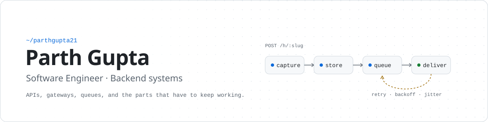

<picture>
  <source media="(prefers-color-scheme: dark)" srcset="./assets/banner-dark.svg">
  <source media="(prefers-color-scheme: light)" srcset="./assets/banner-light.svg">
  
</picture>

 

 

## About

I'm a software engineer who mostly works on the backend: HTTP APIs, gateways, background workers, and the queues between them. I like the problems that show up once a system is real, such as a downstream service that is slow, a request that arrives twice, or a job that dies halfway through. Most of what I build here is about handling those cases properly.

- **Reliability first.** Persist before processing, retry with backoff, make replays idempotent, and sweep up the jobs that slip through.
- **Security as part of the design.** JWT auth, role-based access, rate limits, audit logs, SSRF guards on outbound calls.
- **Systems you can operate.** Structured logs, Prometheus metrics, health checks, Docker images, and CI that tests against real MySQL and Redis.

I also practise data structures and algorithms in C++ ([DS-and-algos](https://github.com/parthgupta21/DS-and-algos), [Coding-Contests](https://github.com/parthgupta21/Coding-Contests)).

## Featured: RELAY

<table>
<tr>
<td>

**A hosted, multi-tenant webhook gateway.** Senders post to a stable RELAY URL and get a fast response. RELAY stores the request first, then a separate worker delivers it to your destinations as signed HTTP requests, with retries and replay. Your server can be down or redeploying without losing the event.

- **Capture:** the raw body is stored byte for byte, so sender signatures still verify downstream. Optional per-endpoint idempotency header, body size limits, rate limits and quotas.
- **Delivery:** BullMQ worker, HMAC-SHA256 signatures, exponential backoff with jitter, `Retry-After` support, concurrency caps, and a sweeper for stuck deliveries.
- **Replay:** replay any event or delivery. `Idempotency-Key` is required, so a retried replay request returns the stored response.
- **Operations:** live inspector over Socket.IO, delivery analytics (success rate, p50/p95 latency), Prometheus metrics, an operator admin API, and a production Docker Compose stack with a deploy workflow.

Node.js · Koa · MySQL · Sequelize · Redis · BullMQ · Socket.IO · React 19 · Vite · Tailwind CSS · shadcn/ui · Docker · Nginx · GitHub Actions

[**relay-backend →**](https://github.com/parthgupta21/relay-backend) &nbsp;&nbsp; [**relay-frontend →**](https://github.com/parthgupta21/relay-frontend)

</td>
</tr>
</table>

## Selected projects

<table>
<tr>
<td width="50%" valign="top">

### [auth-rbac-gateway](https://github.com/parthgupta21/auth-rbac-gateway)

A Koa API gateway that handles identity so upstream services don't have to: JWT access and refresh tokens, RBAC permissions, Redis rate limiting, audit logging, and proxying with identity headers. Ships with Prometheus metrics, OpenTelemetry instrumentation and an OpenAPI spec.

Koa · MySQL · Sequelize · Redis · OpenTelemetry · Docker

</td>
<td width="50%" valign="top">

### [mini-ecommerce-backend](https://github.com/parthgupta21/mini-ecommerce-backend)

An e-commerce backend split into user, product and order services behind an API gateway. Each service runs in its own container and finds the others through Docker's internal DNS. Timeouts on service-to-service calls return a clean `503` instead of letting one slow service hang the rest.

Node.js · Express · Axios · Docker Compose

</td>
</tr>
<tr>
<td width="50%" valign="top">

### [asynchronous-task-orchestrator](https://github.com/parthgupta21/asynchronous-task-orchestrator)

AtlasJS, a framework-free task orchestrator that runs in the browser. A FIFO scheduler with a concurrency limit, a task state machine that rejects illegal transitions, pause, resume and cancel, history that survives a page reload, and explicit cleanup to avoid memory leaks.

Vanilla JavaScript · Event system · localStorage

</td>
<td width="50%" valign="top">

### [content-sense-ai](https://github.com/parthgupta21/content-sense-ai)

A text analysis API that returns sentiment and topics using Google's Gemini model. Requests go through Joi validation, API-key auth and a Redis-backed rate limiter before they reach the model.

Node.js · Express · Gemini API · Redis · Docker

</td>
</tr>
</table>

<b>Earlier full-stack work</b>

 

| Project | What it is | Stack |
| --- | --- | --- |
| [Form-Builder-App](https://github.com/parthgupta21/Form-Builder-App) | Drag-and-drop form builder | Next.js · TypeScript · Prisma · PostgreSQL |
| [horizon-banking-app](https://github.com/parthgupta21/horizon-banking-app) | Banking dashboard with linked accounts and transfers | Next.js · TypeScript · Plaid · Dwolla · Appwrite |
| [Video-Calling-Realtime-Chat-App](https://github.com/parthgupta21/Video-Calling-Realtime-Chat-App) | Chat and video calling with friend requests | React · Express · MongoDB · Stream |
| [Codeflex](https://github.com/parthgupta21/Codeflex---An-AI-trainer-app) | AI fitness program generator | Next.js · Convex · Clerk · Vapi |

## Toolbox

<table>
<tr>
<td><b>Languages</b></td>
<td>

</td>
</tr>
<tr>
<td><b>Backend</b></td>
<td>

</td>
</tr>
<tr>
<td><b>Data</b></td>
<td>

</td>
</tr>
<tr>
<td><b>Frontend</b></td>
<td>

</td>
</tr>
<tr>
<td><b>Ops</b></td>
<td>

</td>
</tr>
</table>

 

Always up for a good engineering conversation. Find me on <a href="https://x.com/honoured_0ne_">X</a> or <a href="https://hashnode.com/@ParthGupta">Hashnode</a>.

